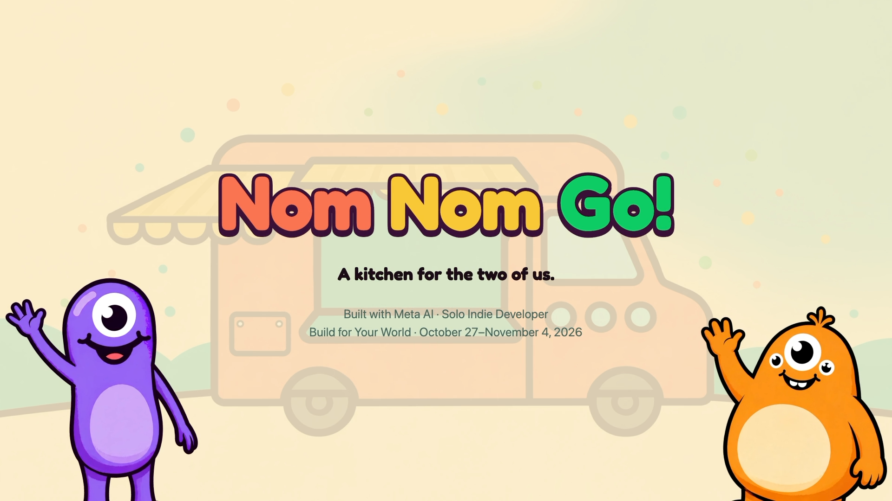
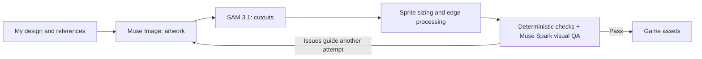

# Nom Nom Go!

A kitchen to share across continents. Built for my son, made possible with Meta AI.

I live in the UAE. My seven-year-old son lives in the USA. We love cooking together, but most of our time together happens on video calls.

I built **Nom Nom Go!** to give us a kitchen we could share across that distance: silly monsters to feed, burgers to build, and my voice calling out the ingredients. A space in the upper-right corner leaves room for my video during our call, so Dad can stay beside the action.

The gameplay also draws on feedback from his teachers about skills he’s working on. Remembering an order, following a sequence, and choosing the right ingredients give us playful ways to practice those skills together. I wanted to bring that practice into something we already love: cooking.

Meta AI made it possible for me to turn that idea into a personalized game—with its own characters, artwork, recorded voice cues, and carefully paced challenges. It brings together creative and technical work I couldn’t have done on my own without these tools. The goal is simple: more ways for us to connect.

**Meta Global AI Developer Hackathon · Indie Developer track · Build for Your World**

[](https://www.youtube.com/watch?v=NQIBh6xn3eo)

## Inside our kitchen

Monsters arrive at the kitchen window and babble their orders. The Head Chef repeats each ingredient in my voice while its picture lights up. Then it’s time to build the burger: tap the ingredients in order and ring the serving bell. A successful order gets a monster munch, a happy reaction, and a celebration.

The Head Chef is always there to help. Tapping him pauses the game and repeats the order, with matching ingredient highlights, as often as needed. A wrong serve gives another chance at the same order. The six levels gradually introduce more demanding orders, ending with a Rush Hour boss and a kitchen-closing sequence that gives our session a natural finish.

**Dad’s Window** is the reserved upper-right space for the video-call overlay while we screen-share. Our existing video call provides the video and conversation; the game keeps its controls out of that corner.

## How Meta AI made it possible

I supplied the personal context, reviewed the game specification, directed the design, and recorded my voice. Meta’s tools helped turn those choices into a working game and a consistent illustrated world.

| Tool | Role in the build | Evidence in this repository |
| --- | --- | --- |
| **Muse Wonder in Muse Code** | Helped implement the game from a detailed, reviewed specification, covering gameplay, audio, persistence, and tests. | [Build specification](docs/wonder-prompt.md), [game source](game/src) |
| **Muse Image** | Generated characters, ingredients, props, and scenes from asset descriptions and visual references. | [Asset manifest](tools/art/manifest-v2.json), [generation pipeline](tools/art/art.py) |
| **SAM 3.1** | Segmented subjects so generated artwork could become transparent, reusable game sprites, with additional edge and transparency processing. | [Segmentation tool](tools/art/sam_cut.py), [sprite processing](tools/art/art.py) |
| **Muse Spark** | Evaluated asset readability and consistency, and compared rendered screens with approved storyboards to identify visual issues. | [Asset QA](tools/art/art.py), [screen QA](tools/art/screen.py) |



The asset pipeline checks dimensions and transparency alongside Spark’s visual review. Failed assets get bounded retries and are quarantined if they still fail. A failed revision preserves the previously accepted asset. Screen checks also inspect layout, touch targets, and the reserved video-call corner.

**My voice is a real recording.** The 40 order and ingredient clips are me speaking to my son, not an AI-generated voice. The models helped create the world; my voice makes it our kitchen.

## Built around how he plays

- **Practice that adapts locally.** The game tracks different kinds of mistakes and adjusts timing, order complexity, and ingredient choices within each level’s limits. Running out of time eases time pressure; mixing up similar ingredients eases the search challenge. These adjustments happen on the device.
- **Help without pressure.** Picture cues and spoken orders support play without reading. Help is unlimited and pauses the patience timer while the order repeats.
- **Predictable, testable rules.** A pure TypeScript game reducer uses seeded randomness and explicit time inputs, making game sequences reproducible. Tests cover solvable orders, retries, progression, saves, and difficulty adjustments.
- **A game that can travel.** Solo gameplay, artwork, and recorded audio work offline after the service worker has cached the assets. Sharing a call still needs a connection.

The core game has no accounts, ads, analytics, or trackers, and no model inference runs during play. Progress, settings, skill estimates, and a bounded history of the last 200 orders are stored locally. The game does not ask for a child’s name, photos, voice recording, or typed responses.

Browser tests cover gameplay, voice playback, celebrations, and layouts at phone and tablet sizes. A separate production-preview test checks offline play and cached audio. A persona simulator exercises the actual game reducer to help tune session pacing; its estimates are simulations, not observations of children playing.

## A kitchen that can grow with us

As he grows, I want our kitchen to grow with him: new levels, foods to make, cultures and places to explore, and more things for us to discover together. Burgers are the current playable menu; pizza and sundae content provides a starting point for future expansion.

The first play session with my son is still ahead. This is a game built around his interests and teacher-informed practice, with connection as its purpose. His experience will guide what we build next.

## Built during the hackathon

Built October 27–November 4, 2026 as a solo entry in the **Indie Developer** track of the [Meta Global AI Developer Hackathon](https://cerebralvalley.ai/e/meta-ai-developer-hackathon), addressing **Build for Your World**.

The work includes the game implementation, adaptive gameplay, generated artwork and its production tools, recorded-voice integration, sound integration, and automated checks. Third-party libraries and credited sound sources support the build; the original contribution is their implementation and integration into this personal game experience.

Submission status:

- [x] Public repository
- [x] Hackathon build period and track identified
- [x] Meta model roles documented with source links
- [ ] Add the public live-game URL near the top of this README
- [x] Add the three-minute demo video near the top of this README
- [x] Submit through Cerebral Valley with all contributors listed and accessible links

The [saved participant guide](docs/participant-guide.md) contains the detailed submission requirements and judging rubric. Check the [event details](https://cerebralvalley.ai/e/meta-ai-developer-hackathon/details) for organizer updates.

## Run it

Requires Node 22.12+ or 24.

```bash
npm --prefix game install
npm run dev        # http://127.0.0.1:5173
npm test           # unit tests
npm run test:e2e   # Playwright: phone, tablet, desktop
npm run build     # production build and bundle budget check
```

For a fresh Playwright setup, install browsers with `cd game && npx playwright install` before running the browser tests.

Before deploying to AWS, run `npm run test:deploy` to build and verify the upload
packages and AppSync configuration, then `npm --prefix game run test:e2e:deploy`
to check gameplay, artwork, and offline audio using the files that will be uploaded.
The deployment preserves every build file: hashed bundles use immutable caching,
while artwork, audio, icons, fonts, and other root files use revalidation.

## Explore the implementation

- [Game rules](game/src/core/game.ts), [adaptive difficulty](game/src/core/difficulty.ts), and [pacing simulator](game/src/core/simulator.ts).
- [Voice clip tracker](docs/dad-voice-clips.md): recorded lines, filenames, and source time ranges. Missing recordings fall back to the device’s speech voice.
- [Sound manifest](game/public/audio/sfx/manifest.json) and [source credits](game/public/audio/sfx/CREDITS.txt): monster munches and celebration cues.
- [Art production tools](tools/art) and [shipped artwork](game/public/art).
- [Browser tests](game/tests) and [offline test configuration](game/playwright.offline.config.ts).
- [AWS infrastructure](infra/lib/stack.ts): deployment definitions. The specification and infrastructure also contain an earlier remote-pairing prototype; that is not required for the video-call experience described here.
