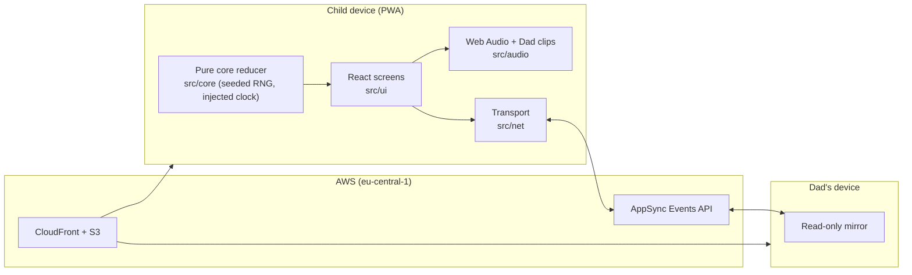

# Nom Nom Go!

A kitchen game for a kid and a parent to play together. Made possible with Meta AI.

I live in the UAE. My son is seven and lives in the USA. We have been apart for years, and most of our time together happens on video calls. I built Nom Nom Go! so we would have something to do on those calls besides ask each other how school went.

[GIF or screenshot goes here once the art pass lands]

## How it plays

Silly monsters pull up to a food truck and order burgers, pizzas, and sundaes. My son watches the order, sees it printed on a ticket in the kitchen, and hears the Head Chef call it out. The Head Chef is my voice. Then he builds the dish by tapping ingredients in the right order before the monster runs out of patience.

There are six levels. The last is a Rush hour boss. When it ends, the kitchen closes for the night, and that is the end of the session. The next time he powers the game on, the kitchen opens fresh for the next customers.

While he plays, I can open "Dad's Window" on my own device. I see what he sees, point at things with a glove to assist, and send a cheer for encouragement. The call brings us together, and the interactions give us connection.

The kid's game is meant to be a small exercise in focus and quick thinking, played with a parent.

## Made for a child with safety first

- No accounts, no analytics, no ads, no trackers.
- No AI runs while he plays.
- Nothing about him is collected: no name, photos, voice, or typed text.
- Progress, settings, pairing, and the last 200 orders stay on his device and are never sent anywhere.
- "Dad's Window" receives only game state, pointer position, and a fixed set of cheers. The pairing id travels in the URL fragment, so it never appears in server logs.
- The game works offline once installed on the Home Screen.

## How Meta AI was used

Muse Wonder, in Muse Code, wrote this codebase from the specification in [`docs/wonder-prompt.md`](docs/wonder-prompt.md). I reviewed and amended that prompt before it built anything.

Art is from Muse Image, with SAM 3.1 for cutting out characters and ingredients. Muse Spark playtested the levels.

## Built during the hackathon

This project was built between Oct 27 and Nov 4, 2026 for the Meta Global AI Developer Hackathon (solo entry, Indie Developer track).

## Run it

Requires Node 22.12+ or 24.

```bash
npm --prefix game install
npm run dev        # http://127.0.0.1:5173
npm test           # unit tests
npm run test:e2e   # Playwright, iPhone and iPad sizes
npm run build      # production build and bundle budget check
```

Deploying to AWS is covered in [`docs/hackathon.md`](docs/hackathon.md).

## How it is built



The game rules are a pure TypeScript reducer with a seeded random generator and an injected clock. They never call `Math.random()` or `Date.now()`, so any game can be replayed exactly. The child's device is the only writer of game state. Dad's Window is a whitelist mirror and cannot see anything else.

Dad's voice clips live in `game/public/audio/clips/`. Any missing clip falls back to the device's speech voice.

## Pairing Dad's Window

1. On Dad's device, open `…/#dad` and choose **Copy pairing link**.
2. Open that link once on the child's device and confirm the picture.
3. Dad opens `…/#watch=<id>` to watch, point, and send cheers.

If the installed Home Screen app does not share storage with Safari, hold the chef-hat icon on the title screen for 3 seconds and use **paste pairing link**.

## Submission checklist

- [x] Public repository
- [x] Built during the hackathon period (Oct 27 – Nov 4, 2026)
- [x] Solo entry, Indie Developer track
- [x] Uses Meta models: Muse Wonder [add others as they are actually used]
- [ ] 3-minute demo video: [link]
- [ ] Submitted on Cerebral Valley

Event rules, dates, and links are in [`docs/hackathon.md`](docs/hackathon.md). Progress notes are in [`docs/progress.md`](docs/progress.md).
