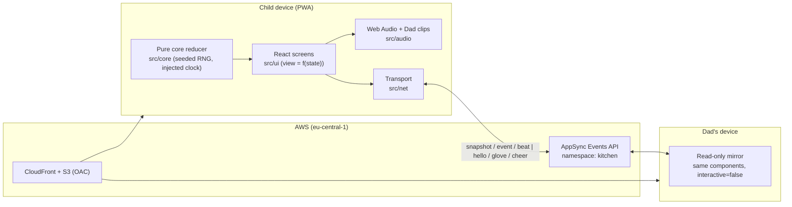

# Meta Global AI Developer Hackathon

Solo entry, Indie Developer track. All times ET.

- **Team:** Cooked Chef (solo developer)
- **Project:** Nom Nom Go!
- **One-liner:** A kitchen game where kids practice focus and quick thinking and play with a parent. Made possible with Meta AI.
- **ELI5:** A kids' kitchen arcade game for practicing concentration and quick thinking, together with a parent.

Full rules and details: `docs/participant-guide.md` (copied from the Cerebral Valley event page on Oct 26, 2026).

## Key dates

| Date | Event |
| --- | --- |
| Mon Oct 26, 12:00 PM | Kickoff (livestream) |
| Tue Oct 27, 12:00-1:00 PM | Agents 101: Build a Multimodal AI Agent |
| Wed Oct 28, 12:00-1:00 PM | Agents 102: Best Practices for Verifiable Agents |
| Fri Oct 30, 12:00-1:00 PM | Building Specialized Intelligence on Fireworks |
| Oct 27 - Nov 4 | Building period (Discord office hours 10-11 AM weekdays) |
| Mon Nov 2 | Own target: feature freeze |
| Wed Nov 4, 9:00 PM | Submissions due, credit claim deadline |
| Nov 5 - 8 | Judging |
| Mon Nov 9, 12:00 PM | Closing ceremony, top 10 announced |
| Mon Nov 16 | Community vote winner announced |

## Submission requirements

- Public repository
- 3-minute demo video showing only what was built during the hackathon
- Submit via the Cerebral Valley platform
- Project must use Meta models (Muse Spark series, Muse Wonder, Muse Image, Muse Voice Transcribe, SAM 3.1, Muse Glimmer, Muse Spark Open)

## Links

- Notion workspace: https://app.notion.com/p/405e34f437ae81fbb496db802ac45f94
- Event details: https://cerebralvalley.ai/e/meta-ai-developer-hackathon/details
- Livestream: https://cerebralvalley.ai/e/meta-ai-developer-hackathon/live
- Discord: https://cerebralvalley.ai/e/meta-ai-developer-hackathon/discord
- Submit: https://cerebralvalley.ai/e/meta-ai-developer-hackathon/hackathon/submit
- Meta docs: https://dev.meta.ai/docs/overview
- Meta Model API cookbook: https://github.com/meta-models/meta-model-cookbook
- Open model cookbook: https://github.com/meta-models/meta-oss-cookbook

---

# Nom Nom Go!

**A kitchen game where kids practice focus and quick thinking and play with a parent. Made possible with Meta AI.**

A dad in the UAE built this to play with his 7-year-old son in the USA during video calls (Messenger Kids), after being separated for years. Silly monsters order burgers, pizzas, and sundaes at a food truck. The child watches the order, sees it printed in the kitchen, hears the Head Chef call it out in Dad's own voice, then builds the dish by tapping ingredients in the right order before the monster's patience runs out. Six levels end in a "Rush hour" boss, after which the kitchen closes for the night. Dad can watch and cheer live from another device ("Dad's Window") while they talk on the call.

The full build specification is in `docs/wonder-prompt.md`.

## Run, test, deploy

Requires Node 22.12+ or 24 (`.nvmrc` pins 24).

```bash
npm --prefix game install
npm run dev        # http://127.0.0.1:5173
npm test           # Vitest core tests
npm run test:e2e   # Playwright (iPhone 15 / iPad Pro 11 WebKit + Chromium)
npm run build      # production build + split deploy output + bundle budget check
npm run deploy     # builds, then cdk deploy --profile valerian253 (eu-central-1) — ask Dad before the first bootstrap/deploy
npm run destroy
```

Offline PWA check: `npm --prefix game run build`, serve `game/dist` with `vite preview`, then `OFFLINE=1 npx playwright test --config playwright.offline.config.ts` from `game/`.

## Architecture



- The game core is a pure TypeScript reducer with a seeded RNG and injected clock. It never uses `Math.random()` or `Date.now()`, and never schedules timers.
- The child device is the only writer of game state. Dad's Window is a whitelist mirror (`MirrorView`), so telemetry, pairing ids, and save data never leave the child's device.
- Dad's voice clips live in `game/public/audio/clips/`; see `docs/recording-script.md`. Missing clips fall back to the device speech voice.

## Privacy

What is collected: **nothing leaves the child's device.** No accounts, no analytics, no ads, no trackers, no AI at runtime, and no personal data about the child — no name, photos, voice, or free text. Progress, settings, pairing, and on-device order history (last 200 orders, never sent) live in `localStorage` only. Dad's Window messages carry only game state, normalized pointer coordinates, and fixed enums. The pairing id travels in the URL fragment, so it never appears in server logs. The only runtime network traffic after first load is `config.json` and the Dad's Window connection.

## Pairing Dad's Window

1. On Dad's device open `…/#dad`, then **Share / Copy pairing link**.
2. Open that link once on the child's device. A picture-only confirmation appears and pairing is stored on the device.
3. Dad opens `…/#watch=<id>` to watch, point with a glove, and send cheers.

Home Screen apps may not share storage with Safari. If pairing does not carry over to the installed app, open the parent area on the child's device (hold the chef-hat icon on the title screen for 3 seconds) and use **paste pairing link** instead.

## Power off / power on

There is no start-over button and no reset in the parent area. After the boss, the kitchen closes for the night. The closed screen has a power-off button: it puts the game to sleep, and the next power-on starts completely fresh at Level 1 — progress, stars, and order history reset, while Dad's Window pairing and the sound setting stay paired and set.

## Dad's Window operations notes

- The AppSync API key in `config.json` is created with the longest allowed expiry (365 days). When it expires, Dad's Window silently stops connecting (solo play is unaffected). To rotate it, redeploy (`npm run deploy`), which issues a new key and rebuilds `config.json`.
- Re-pairing from the parent area rotates the kitchen id; any Dad window open on the old id is orphaned and must use the new link.

## How Meta AI was used

Muse Wonder in Muse Code built this codebase from the specification in `docs/wonder-prompt.md`. Muse Image + SAM 3.1 will produce the final art in a separate step (the game currently ships with intentional placeholder art defined in `game/public/art/manifest.json`). Muse Spark playtesting is a separate later step. No AI runs at runtime in the game.

## Built during the Meta Global AI Developer Hackathon (Oct 27 – Nov 4, 2026)

- Oct 28: build prompt reviewed, amended, and approved (`docs/wonder-prompt.md`).
- Oct 28: game scaffold, pure core with seeded order generation, levels, pace, comparison, saving, boss and power cycle; placeholder screens; audio with Dad-clip playback and speech stand-in; Dad's Window over LocalTransport and AppSync; CDK infrastructure for CloudFront, S3, and AppSync Events. Unit, Playwright (iPhone/iPad/Chromium), offline, and `cdk synth` checks passing.
- Remaining before submission: deploy after Dad's approval, real art pass, Dad's recorded clips, real-device checklist below.

## Real-device checklist (manual)

- [ ] Sound with the silent switch on and off
- [ ] Sound during a Messenger Kids call in picture-in-picture
- [ ] Return from the background mid-order
- [ ] Airplane-mode play from the Home Screen icon
- [ ] Pairing from the installed app (including the paste-link fallback)
- [ ] Call corner with a real PiP window over the game
- [ ] Dad's Window between two real devices after deploy
